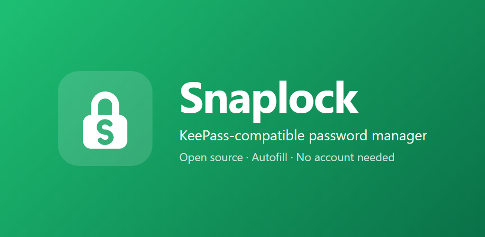

<p align="center">
  
</p>

<p align="center">
  <a href="https://github.com/erenmalkoc/snaplock-v2/releases/latest"></a>
  <a href="https://github.com/erenmalkoc/snaplock-v2/actions/workflows/ci.yml"></a>
  <a href="LICENSE"></a>
  
  <a href="fdroid/PUBLISHING.md"></a>
</p>

**Snaplock** is a fast, private password manager for Android that works with standard
KeePass (`.kdbx`) databases. Your vault is a single encrypted file that you own: keep it
on the device or sync it through any cloud storage or Syncthing folder. No account, no
tracking, no ads.

## Download

- **GitHub:** signed APKs on the [releases page](https://github.com/erenmalkoc/snaplock-v2/releases/latest).
- **F-Droid:** inclusion is in review. F-Droid will ship the same signed APK, so you can
  switch between the two without reinstalling.

Every release is built reproducibly from its tag: anyone can rebuild the APK and get the
same bytes. Signing certificate SHA-256:
`e66b0d23e679d1d606573be6f705630f9f90e74be084ec4b59d1181ae608b8b7`

## Features

- **KeePass compatible.** Opens and saves KDBX 4 databases from KeePassXC, KeePass,
  KeePassDX and Keepass2Android, on any storage Android's file picker can reach.
- **Autofill.** Fills logins in apps and browsers, with suggestions in the keyboard on
  Android 11 and later. Websites are only matched when a known browser reports them, so a
  web page inside another app cannot ask for your credentials.
- **Works with your existing links.** Reads the app and URL links KeePassDX,
  Keepass2Android and KeePassXC store in entries.
- **The whole KeePass vault.** Nested groups, custom fields (protected or plain), file
  attachments, entry history you can restore from, and a recycle bin.
- **Key files.** Unlock with a password, a key file or both, and change the master
  password at any time.
- **Biometric unlock** with a key kept in the Android Keystore.
- **Recent databases** to reopen a vault in one tap.
- **Password generator** with length and character-set options.
- **Clipboard clearing** after a configurable delay.
- **Auto-lock** when Snaplock leaves the screen, immediately or after a delay.
- **Material You** colours, light and dark themes, English and Turkish.

## Privacy and security

- Snaplock has no internet permission. The database never leaves the file you chose.
- The decrypted database lives only in memory and is dropped when the vault locks.
- Screenshots, screen recordings and the recents preview are blocked in release builds.
- For biometric unlock, the master password is encrypted with an Android Keystore key
  that requires your fingerprint or face, is invalidated when new biometrics are
  enrolled, and is excluded from backups and device transfers.

## Build and test

```bash
./gradlew testDebugUnitTest
./gradlew assembleDebug
./gradlew assembleRelease
```

Release builds enable code and resource shrinking; project-specific rules live in
`app/proguard-rules.pro`. How releases are built, signed and verified for F-Droid is
described in [fdroid/PUBLISHING.md](fdroid/PUBLISHING.md).

## Project structure

- `domain`: repository contracts, models and use cases
- `data`: Kotpass data source, session cache, preferences, clipboard helper
- `autofill`: autofill service, form detection and entry matching
- `presentation`: ViewModels and UI state
- `ui`: Compose screens, reusable components, navigation and theme
- `di`: Hilt bindings

## License

Snaplock is free software licensed under the GNU General Public License v3.0 or later.
See [LICENSE](LICENSE).
