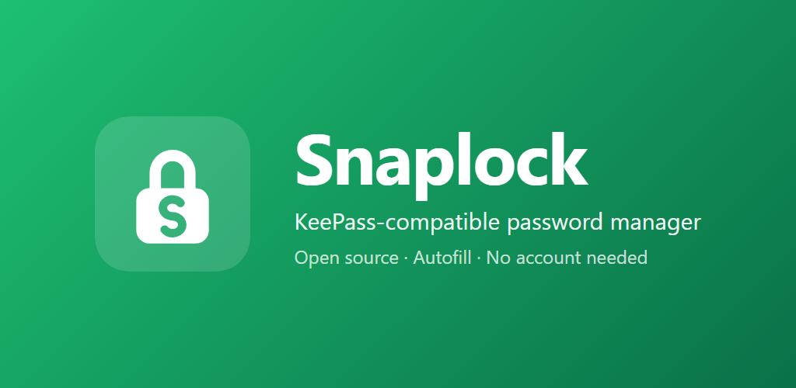
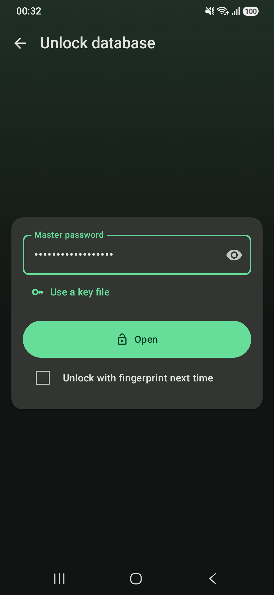
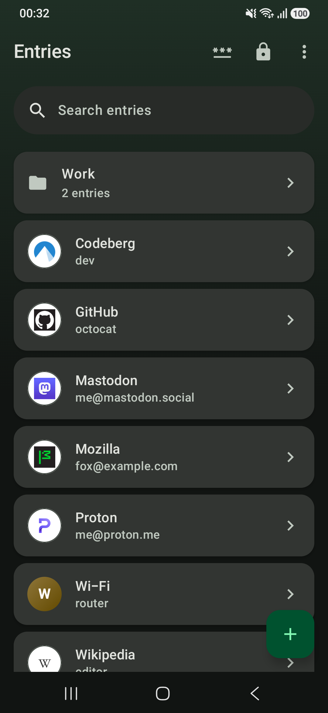
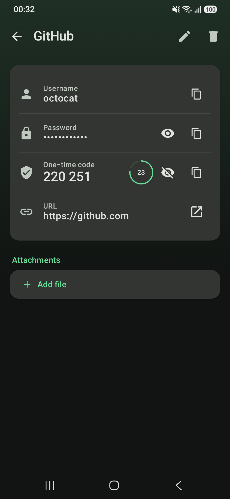
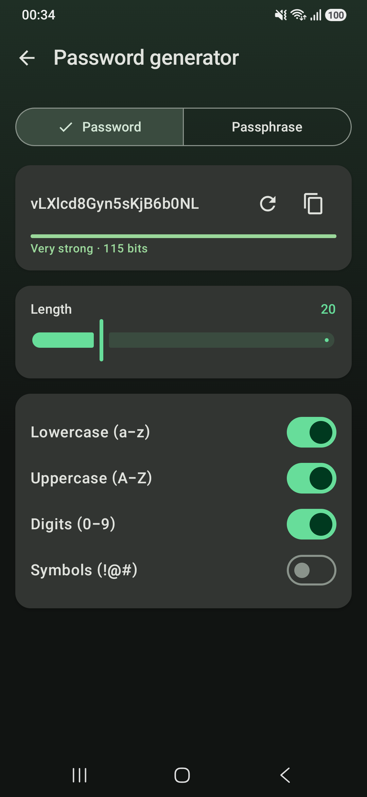
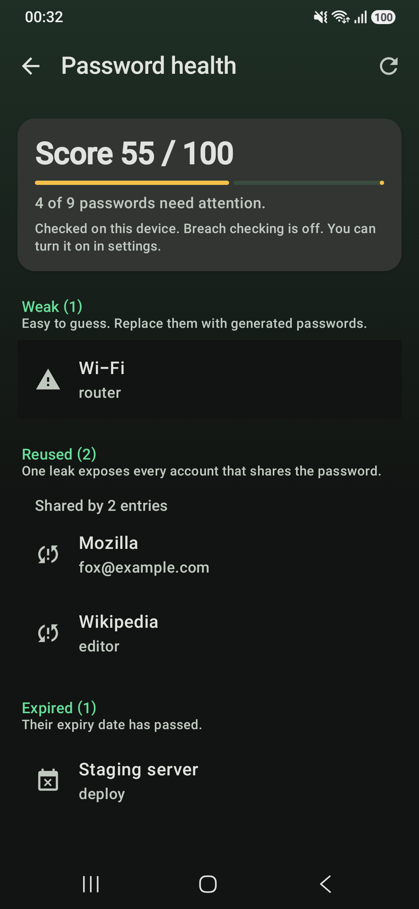
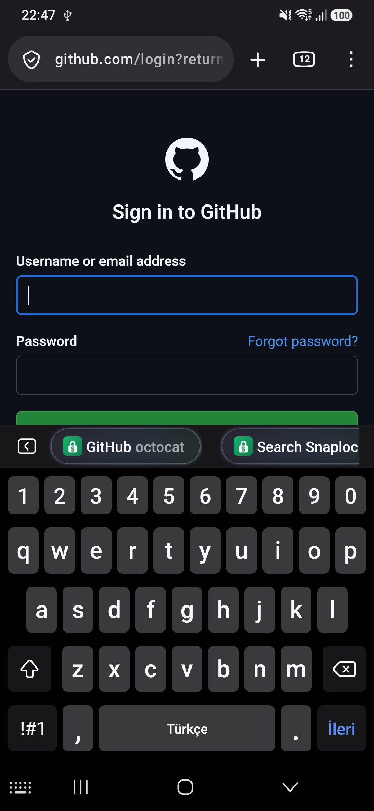
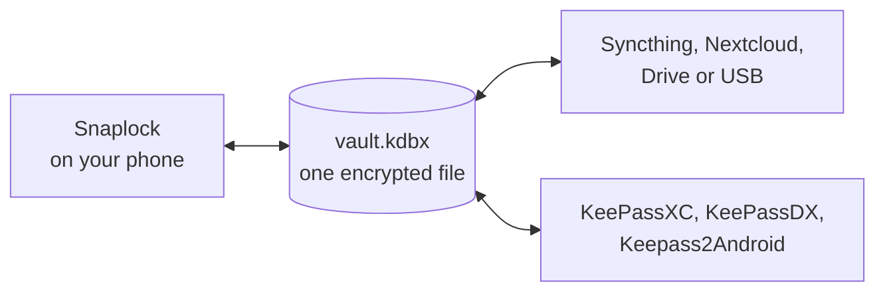

<p align="center">
  
</p>

<h3 align="center">Your passwords live in one file you own.<br>Snaplock is the fast, private Android app that opens it.</h3>

<p align="center">
  <a href="https://github.com/erenmalkoc/snaplock-v2/releases/latest"></a>
  <a href="https://github.com/erenmalkoc/snaplock-v2/actions/workflows/ci.yml"></a>
  <a href="LICENSE"></a>
  
  <a href="fdroid/PUBLISHING.md"></a>
</p>

<p align="center">
  <a href="#download"><b>Download</b></a> ·
  <a href="#why-snaplock">Why Snaplock</a> ·
  <a href="#features">Features</a> ·
  <a href="#how-your-vault-syncs">Sync</a> ·
  <a href="#privacy-and-security">Privacy</a> ·
  <a href="#verify-your-download">Verify</a> ·
  <a href="#build-from-source">Build</a>
</p>

<p align="center">
  
  
  
  
  
  
</p>

## Why Snaplock

- **No account, no server, no lock-in.** Your vault is a standard KeePass file. Keep it on
  the phone, or let Syncthing, a cloud drive or Nextcloud carry it. Open the same file in
  KeePassXC, KeePassDX or Keepass2Android any time.
- **Everything KeePass has.** Nested groups, custom fields, attachments, entry history, a
  recycle bin, key files, TOTP codes and passkeys, in one modern Material 3 app.
- **Quiet by default.** Snaplock goes online only for two optional features, and only after
  you switch them on. There is no analytics, no ads and no tracker.
- **Builds you can check.** Every release is built reproducibly from its tag, so anyone can
  rebuild the APK and compare it byte for byte.

## Download

| Where | Status |
| --- | --- |
| **GitHub** | Signed APKs on the [releases page](https://github.com/erenmalkoc/snaplock-v2/releases/latest). |
| **F-Droid** | In review. F-Droid ships the same signed APK, so you can switch between the two without reinstalling. |

Requires Android 7.0 or later.

## Features

| | |
| --- | --- |
| **Open and sync** | Opens and saves KDBX 4 databases from KeePassXC, KeePass, KeePassDX and Keepass2Android on any storage the Android file picker reaches. Merges changes made by Syncthing or a cloud drive before saving instead of overwriting them, the way KeePass synchronises. |
| **Sign in everywhere** | Autofill in apps and browsers with suggestions in the keyboard (Android 11+). Passwords and passkeys in the system sign-in sheet on Android 14+, stored the way KeePassXC stores them. Reads the app and URL links other KeePass apps keep. |
| **Two-factor codes** | Shows TOTP and Steam Guard codes, adds new ones from a setup key, a camera QR scan or a QR screenshot, and fills them into one-time code fields. |
| **Organise** | Nested groups, protected and plain custom fields, file attachments, restorable history, recycle bin, site icons, and a two-pane layout on tablets and foldables. |
| **Stay safe** | Password and passphrase generator with a strength meter, a health report for weak, reused, old and expired passwords, clipboard clearing, auto-lock, and daily backups kept on the device for 7 days. |
| **Make it yours** | Choose AES-256, ChaCha20 or Twofish with Argon2d, Argon2id or AES-KDF, and let a benchmark tune unlocking to about a second on your phone. Import CSV from Bitwarden, Chrome, Firefox, 1Password, Proton Pass, LastPass and KeePassXC. Light and dark themes, English and Turkish, a Quick Settings tile and launcher shortcuts. |

## How your vault syncs



Snaplock never talks to a Snaplock server, because there is none. The file is the only
thing that moves, and it is encrypted before it leaves the app.

## Privacy and security

<details>
<summary><b>What Snaplock does, and what it never does</b></summary>

- The database never leaves the file you chose, and Snaplock has no account or server.
- Snaplock goes online only for two optional features, and only after you turn them on:
  - The breach check sends the first 5 characters of each password's SHA-1 hash to Have
    I Been Pwned (k-anonymity), never a password or a full hash.
  - Site icon downloads ask each website directly for its own icon (or the server its
    page names for it). No icon service sees the list of sites you use.
- Passkeys answer for a website only when the request comes from a browser on Google's
  list of privileged browsers. Any other app gets signatures bound to its own signing
  certificate, which websites reject unless they trust that app.
- The decrypted database lives only in memory and is dropped when the vault locks.
- Screenshots, screen recordings and the recents preview are blocked in release builds.
- Fingerprint unlock keeps the master password encrypted with an Android Keystore key that
  needs your fingerprint, is invalidated when new fingerprints are enrolled, and is
  excluded from backups and device transfers.

</details>

## Verify your download

Every release is built reproducibly from its tag on Debian, then rebuilt on another JDK,
path and core count, and both builds must match before the APK is signed. F-Droid does the
same comparison independently. To check an APK yourself:

```bash
apksigner verify --print-certs snaplock-X.Y.Z.apk
```

The signing certificate SHA-256 must be:

```
e66b0d23e679d1d606573be6f705630f9f90e74be084ec4b59d1181ae608b8b7
```

How releases are built, signed and compared is described in
[fdroid/PUBLISHING.md](fdroid/PUBLISHING.md).

## Build from source

```bash
./gradlew testDebugUnitTest
./gradlew assembleDebug
./gradlew assembleRelease
```

Release builds enable code and resource shrinking, with project rules in
`app/proguard-rules.pro`.

<details>
<summary><b>Project structure</b></summary>

- `domain`: repository contracts, models and use cases
- `data`: Kotpass data source, session cache, preferences, clipboard helper
- `autofill`: autofill service, form detection and entry matching
- `credentials`: Credential Manager provider for passwords and passkeys
- `tile`: Quick Settings tile
- `presentation`: ViewModels and UI state
- `ui`: Compose screens, reusable components, navigation and theme
- `di`: Hilt bindings

</details>

## License

Snaplock is free software licensed under the GNU General Public License v3.0 or later.
See [LICENSE](LICENSE).

The passphrase generator uses the [EFF large wordlist](https://www.eff.org/dice) by the
Electronic Frontier Foundation, licensed under
[CC BY 3.0 US](https://creativecommons.org/licenses/by/3.0/us/).
